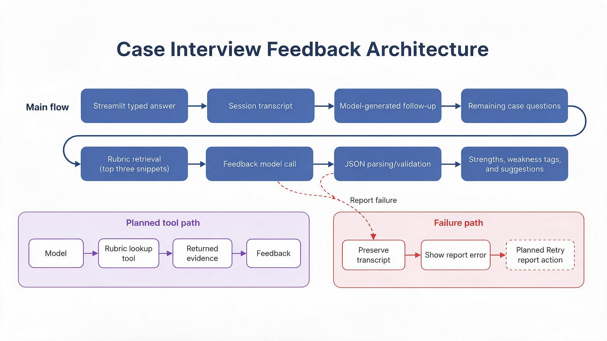

## Workshop checkpoint

Team name: Team 7, PM CaseCoach

Members:

* Jimena Gamboa, [jgamboa@bu.edu](mailto:jgamboa@bu.edu)
* Max Lattermann, [mlatterm@bu.edu](mailto:mlatterm@bu.edu)
* Jacobo Naranjo Guerrero, [jacobon@bu.edu](mailto:jacobon@bu.edu)
* Caitlin Yu, [caitliny@bu.edu](mailto:caitliny@bu.edu)

### 0. Team infrastructure

* GitHub repository: https://github.com/caitlinyu98/IS883-Project-PM-CaseCoach
* Project board (GitHub Projects, §5.7): https://github.com/users/caitlinyu98/projects/1
* Streamlit app URL: https://is883-project-pm-casecoach.streamlit.app/
* Attending the Oct 23 workshop? Yes

### 1. The project, as it stands today

* **Who the user is:** An MBA student preparing for a Product Manager internship or full-time job interview for a B2B technology company.
* **The task, in one sentence:** To practice answering PM interview questions in a realistic written mock-interview setting and receive actionable feedback to improve future performance.
* **The user's input, and what comes back to the user:** The candidate types answers to four B2B PM written case questions and adaptive follow-ups. The intended output is a final structured report with strengths, weakness tags, and actionable suggestions.
* **Every source the app reads (§3.2):**
  * Lenny’s Data: https://github.com/LennysNewsletter/lennys-newsletterpodcastdata and evidence of permitted use as a free subscriber with [jgamboa@bu.edu](mailto:jgamboa@bu.edu) of Lenny’s Substack Newsletter https://prnt.sc/qf_vdsza8EKz
  * 5 job postings for current PM roles which are publicly shared in each company’s linkedin or web pages: https://drive.google.com/drive/folders/19T9uIWG9JZUat56vrQfVPImY9JGVpvjz?usp=drive_link
  * Original questions and rubrics written by our team based on linkedin experts information about interview’s structures supported by AI assistance (in process)
  * The Gemini API free tier, used only as the language model.

### 2. What changed since the proposal

* **What we changed in what we build or how we build it, and why:** We do not ask the user which type of company anymore. The current draft focuses on four fixed text-only B2B questions with adaptive follow-ups and the final report. This makes feedback quality testable within a narrow demo.
* **What the proposal feedback asked for, and what we did about it:**
  * It said to back up our sources, which we did in the sources section.
  * It also asked to specify whether job descriptions were pasted by the user or collected by us and from where, so we made sure to include this information in the sources section as well.
  * It also asked to acknowledge that if our test users are real people we need written consent on their personal data management, so we plan to make them sign a clear consent (what data is stored, why, and which third parties would have access to it) when they test our product.
  * It also asked for a real scope cut, so we decided to replace the company-type selector with a four fixed question set for B2B companies and fixed follow-ups per question.
  * It also asked to change our success metric, so we followed your suggestion and decided to set our success metric as the % of planted weaknesses the app identifies, using a set of 20 answers written by our team, each with a different planted weakness. We will also add a quick set of knowledge or satisfaction questions at the end of each session as a secondary metric, to capture something our main metric can’t: whether the app is actually useful to the user.

### 3. Where the build stands

**What a user can do on the deployed app today:** We have an MVP in main and are working to make it run. The intended flow is a four-question typed interview with adaptive follow-ups and a final feedback report. A working end-to-end session on the deployed URL has not yet been confirmed.

**Capabilities from §5.1:**

| Capability | Where it fires | Status |
| --- | --- | --- |
| Structured output | Follow up and feedback steps ask the model for JSON. Our code parses it, validates fields, and drops tags that are not on the allowed list. Parse failures use a fallback question or one retry. | Working. Known gap: no fixed response schema yet, so types can slip through. |
| Retrieval | Rubric snippets are embedded. The closest three to the student's answers are added to the feedback prompt, so they change the report. | In progress. Only 7 draft snippets, and follow-up questions do not use retrieval yet. |
| Tool calling | A function the model chooses to call, such as a rubric lookup by weakness tag, whose result changes the feedback. | Not started. |

**Architecture diagram sketch:** 

### 4. Success metric

* **The one number:** Weakness tag recall. Of the weaknesses we deliberately plant in test answers, the share that the feedback report tags correctly. It is computed by `eval/run_eval.py`, not judged by eye.
* **Where the test inputs will come from:** At least 20 realistic PM case answers, written or collected by team members and classmates who consent to this use. They include awkward ones: very short answers, off-topic answers, and confident but flawed answers. For these "awkward" ones, we may rely on AI-generated answers.
* **How expected results are recorded:** The planted weaknesses for each answer are written into `eval/test_set.csv` before any run, so correctness is never decided after seeing the output.

### 5. Proof of concept: two test inputs

Both inputs answer question 1 in `prompts.py`: "You are the PM for a B2B SaaS tool used by finance teams to approve invoices. Customers say approvals take too long. How would you approach this?" Each is run in a full four question session with the other answers held constant.

**Input A, an ordinary input.**
* Input: I would first establish where the delay occurs: incomplete invoice data, unclear ownership, or too many approval handoffs. I would segment customers by company size and approval complexity, then interview accounts-payable managers and approvers while reviewing timestamps from each workflow stage. If handoffs are the main bottleneck, I would pilot automated reminders and escalation rules with mid-market customers before investing in a full workflow redesign. That is lower effort than replacing the approval system and preserves current audit trails. I would compare the pilot with the current process before expanding it.
* Expected result, written before running: The interviewer should ask which specific KPI and baseline would show whether the pilot worked. The report should tag no_success_metric (the answer promises a comparison but never defines a measurable outcome, such as median invoice approval time), recognise the sound diagnosis, segmentation, and phased rollout, and not invent other weaknesses.
* What the app returned: [not run yet. Fill after running.]

**Input B, an input we expect it to get wrong.**
* Input: I would remove manual approvals for all invoices under $50,000 and roll the change out to every enterprise customer in the next release. Our north-star target would be 90% of invoices approved within 24 hours. This is the obvious solution because humans cause the delay, so I would skip customer interviews and a pilot. If approval speed improves, I would consider the launch a success even without checking how the change affects financial controls, auditability, or fraudulent payments.
* Expected result, written before running: The follow up should challenge the assumption that removing approvals improves the product and ask about control or fraud risk. The report should tag no_tradeoffs_or_risks, no_clear_problem_framing, and no_user_segmentation. Likely failure: the model over-rewards the concrete 90% / 24 hour target and gives an overly positive assessment of a dangerous recommendation.
* What the app returned: [not run yet. Fill after running.]

### 6. The plan to our presentation

| Task | Owner | End date |
| --- | --- | --- |
| Build tool calling (rubric lookup by tag) and wire it into feedback | Max | Oct 30 |
| Measure token cost per interaction for the cost analysis | Max | Nov 4 |
| Fix the request cap so Start over does not reset it, and count embedding and retry calls | Caitlin | Oct 28 |
| Add a retry button for a failed report, and a clear missing key message | Caitlin | Oct 28 |
| Rewrite the 7 rubric snippets, replace starter content, put real owner names in file headers | Jimena | Oct 28 |
| Pin `requirements.txt` and test a cold start | Jimena | Oct 25 |
| Write the 20 row test set with planted weaknesses recorded in advance | Jacobo | Oct 30 |
| Architecture diagram, kept in step with the code | Jacobo | Oct 25 |

These rows must match the cards on the project board.

**What we cut first if behind:** Retrieval for follow up questions. We keep retrieval in the feedback step only.

### 7. What we need from you

We plan to measure the share of planted weaknesses the final report tags correctly. Is that an appropriate primary metric for useful PM interview feedback, and how should we account for false positive tags so the app cannot score well by flagging everything? Related: are weakness labels written by our own team an acceptable ground truth, or do we need a second labeller?
